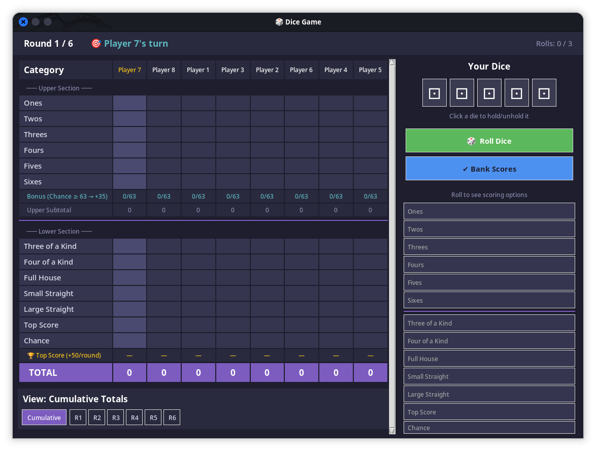

# 🎲 Dice Game

A desktop Yahtzee-style multiplayer dice game written in Python. Features turn-order roll-offs, flexible multiplayer setups (1–8 players), customizable rounds, round-by-round dice history inspection, automated combo banking, and a modern dark theme.



---

## ⚡ Highlights

* **No external dependencies:** Built entirely with Python's standard library and the built-in **TkInter** framework. No `pip install` or external packages required.
* **1 to 8 players:** Configurable player count with customizable player names remembered across sessions.
* **Configurable rounds:** Play anywhere from 1 to 20 rounds (default 6).
* **Decide turn order:** Initial roll-off phase where highest roller goes first, including automatic tie-breaker rolls.
* **Hold and reroll mechanics:** Click individual dice to hold/unhold them across up to 3 rolls per turn.
* **One-click auto-bank:** "✔ Bank Scores" instantly detects and scores all qualifying combinations for the turn.
* **Dual bonus system:**
  * **Chance bonus (+35 pts):** Earned once cumulative Chance points reach ≥ 63.
  * **Round top score bonus (+50 pts/round):** Awarded at the end of every round to the player(s) with the highest score achieved in that round.
* **Round history and review:** Switch between **cumulative totals** and individual rounds (**R1**, **R2**, …) to inspect the exact dice rolled by every player in past rounds.
* **Podium and breakdown:** Post-game rankings with gold/silver/bronze medals and full point breakdown.

---

## 📋 Requirements

* **Python 3.10+**
* **TkInter** (included by default with official Python distributions)
  * *Linux (Fedora):* If Tkinter is not pre-installed on your system, install it via:

    ```bash
    sudo dnf install python3-tk
    ```

  * *Linux (Debian/Ubuntu):* If Tkinter is not pre-installed on your system, install it via:

    ```bash
    sudo apt install python3-tk
    ```

  * *Arch Linux:* If Tkinter is not pre-installed on your system, install it via:

    ```bash
    sudo pacman -S python-tk
    ```

  * *Windows:* If Tkinter is not pre-installed on your system, install it via:

    ```bash
    pip install tk
    ```

  * *macOS:* If Tkinter is not pre-installed on your system, install it via:

    ```bash
    brew install python-tk
    ```

---

## 🚀 How to run

Clone the repository and run:

```bash
python main.py
```

---

## 🎲 Scoring rules

### Upper section

Scored once per round. Each category awards the sum of dice showing that face:

| Category   | Description             | Points   |
| :--------- | :---------------------- | :------- |
| **Ones**   | Sum of dice with face 1 | Up to  5 |
| **Twos**   | Sum of dice with face 2 | Up to 10 |
| **Threes** | Sum of dice with face 3 | Up to 15 |
| **Fours**  | Sum of dice with face 4 | Up to 20 |
| **Fives**  | Sum of dice with face 5 | Up to 25 |
| **Sixes**  | Sum of dice with face 6 | Up to 30 |

### Lower section combinations

Scored once per round. Only the highest qualifying combination among mutually-exclusive combinations can be banked in a single turn:

| Combination         | Requirement                                             | Points     |
| :------------------ | :------------------------------------------------------ | :--------- |
| **Three of a Kind** | At least 3 dice of the same face                        | **25**     |
| **Four of a Kind**  | At least 4 dice of the same face                        | **30**     |
| **Full House**      | 3 of one face + 2 of another face                       | **25**     |
| **Small Straight**  | Sequence of 4 dice (1-2-3-4, 2-3-4-5, or 3-4-5-6)       | **30**     |
| **Large Straight**  | Sequence of 5 dice (1-2-3-4-5 or 2-3-4-5-6)             | **40**     |
| **Top Score**       | All 5 dice identical                                    | **50**     |
| **Chance**          | Sum of all 5 dice                                       | **5 – 30** |

### Bonuses

* **Chance bonus (≥ 63 → +35):** Once a player's cumulative Chance score across all rounds reaches **63 or more**, a one-time **+35 point** bonus is awarded.
* **Round-end top score bonus (+50/round):** After every completed round, the player(s) who scored the most points in that specific round earn **+50 bonus points**.

---

## 📁 Project structure

```text
dice_game/
├── main.py          # Application entry point
├── gui.py           # TkInter user interface (Setup, InitRoll, Game, Results)
├── game_logic.py    # Game rules, dice rolling, score calculation, sheet state
├── settings.py      # Settings loader and saver
├── settings.json    # Persisted player names, count, and round configuration
└── scrot.png        # In-game screenshot
```

> Note: I didn't test everything but I think it's good. I'm open to any suggestions, fixes, etc!
